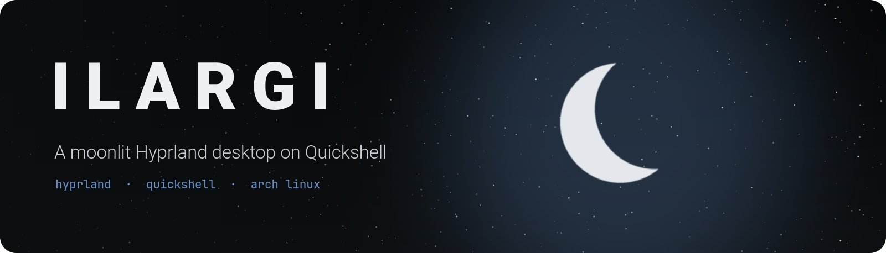
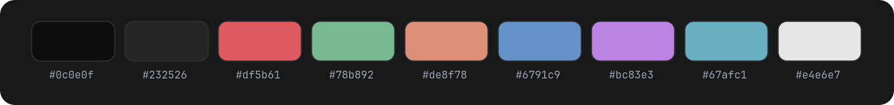
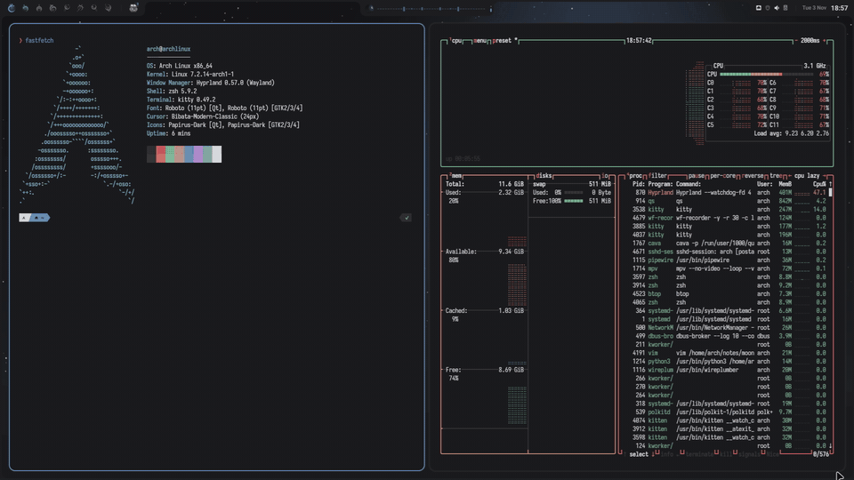
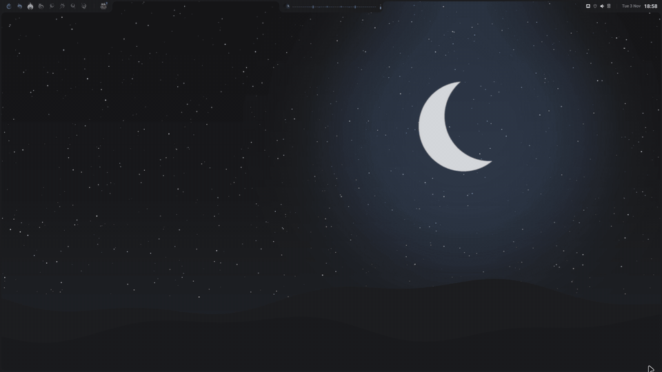
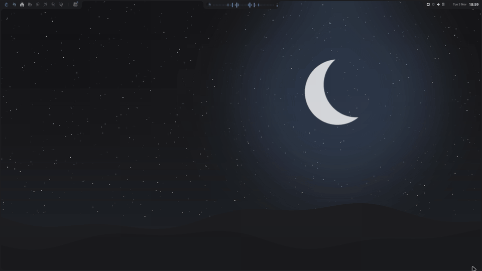
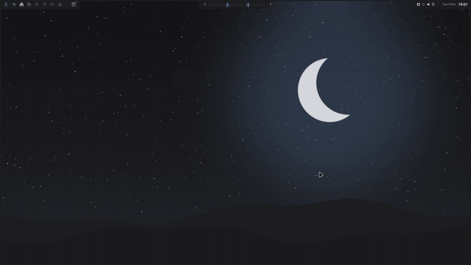
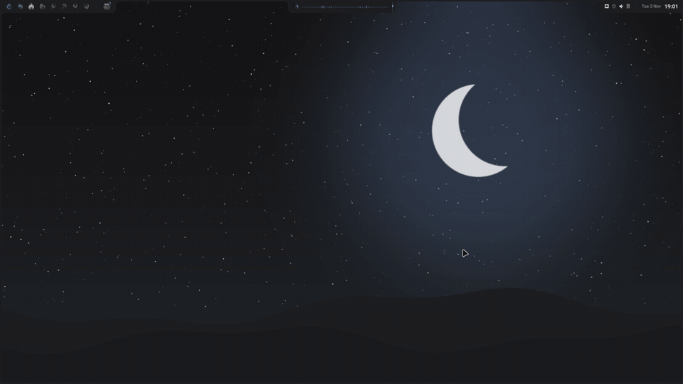
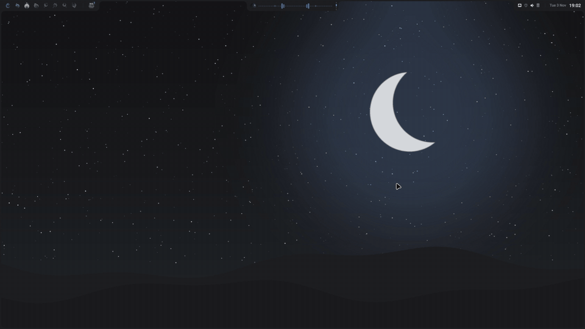

<div align="center">



<br>
<br>


<br>
<br>

<a href="#features"><kbd> <br> Features <br> </kbd></a>&ensp;
<a href="#showcase"><kbd> <br> Showcase <br> </kbd></a>&ensp;
<a href="#install"><kbd> <br> Install <br> </kbd></a>&ensp;
<a href="#keys"><kbd> <br> Keys <br> </kbd></a>&ensp;
<a href="#credits"><kbd> <br> Credits <br> </kbd></a>

<br>
<br>

*Ilargi* is Basque for *moon*. A dark Hyprland desktop built around a Quickshell
shell that is one continuous frame: every panel grows out of the bar or a screen
edge instead of popping up.

</div>

<br>

https://github.com/user-attachments/assets/527ea180-3b4a-443e-aef4-7f8446d325ae

<br>

## Features

### Shell (Quickshell)

- Bar: workspaces, the focused window or what's playing in the centre, and tray
  icons for network, VPN, audio, soundboard, Bluetooth and battery. Anything your
  machine doesn't have stays hidden.
- Aperture (`Super+Shift+Up`): media with a live spectrum, system stats (CPU, RAM,
  GPU, temperatures, network), screenshots and screen recording, and a Displays
  room to arrange monitors. Layouts are saved per set of connected screens.
- Launcher (`Super+D`): fuzzy app search.
- Almanac (`Super+Shift+Right`): calendar with a day dial, timer, stopwatch,
  alarms, and optional Google Calendar and Tasks.
- Clipboard (`Super+Shift+Left`): text, links, colours and images.
- Wallpapers (`Super+Shift+Down`): a picker with an animated transition.
- Session (`Super+Esc`): lock, turn the screen off, suspend, log out, restart or power off.
- Lock screen, notifications, polkit dialogs, Wi-Fi, Bluetooth, WireGuard (with
  a kill switch) and audio panels.
- Soundboard: a virtual mic that mixes your voice (cleaned up with RNNoise) with
  sounds bound to keys. You can search and download sounds from myinstants.

### Everywhere else

- One palette across kitty, zsh (powerlevel10k), vim, GTK 3/4, Qt, KDE apps,
  Firefox, Vesktop, Obsidian, the GRUB menu, the TTY and the login screen.


- Optional login screen: the lock screen's clock and password field running on greetd.

## Showcase

| Desktops | Aperture |
|---|---|
|  |  |
| Launcher | Almanac |
|  |  |
| Clipboard | Wallpapers |
|  |  |
| Session and lock screen | Tray panels |
|  |  |

## Install

Arch Linux (or an Arch-based distro), with a working GPU driver.

```sh
git clone https://github.com/Botxan/ilargi.git ~/ilargi
cd ~/ilargi && ./install.sh
```

The installer is safe to run again. It:
- installs the packages in `packages.txt`
- links the dotfiles, after backing up anything it replaces to
  `~/.local/state/ilargi/backup/`
- detects your keyboard layout, NVIDIA GPU and microphone
- installs oh-my-zsh
- themes Firefox, Vesktop and Obsidian if you have them
- asks before installing the login screen and GRUB theme

Options: `--yes`, `--dry-run`, `--no-packages`, `--system`, `--no-system`.
`sudo system/restore.sh` undoes the system part.

Machine-specific files live in `~/.local/state/ilargi/` and never in the repo:
`local.lua` (keyboard, GPU, devices), `displays.lua` (written by the Displays room),
settings, alarms and calendar tokens.

## Keys

| Key | Action |
|---|---|
| `Super+Return` / `Super+D` | terminal / launcher |
| `Super+1-8`, `Super+Shift+1-8` | go to / send window to desktop |
| `Super+º` `Super+0` `Super+9` | desktops of the other monitors |
| `Super+W` / `Super+M` / `Super+L` | close / fullscreen / float |
| `Super+Shift+Up/Right/Left/Down` | Aperture, Almanac, Clipboard, Wallpapers |
| `Super+Esc` / `Super+Shift+L` | session menu / lock |
| `Print` | screenshot (crop and annotate) |
| `Super+Print` / `Super+Shift+Print` | record screen / region |
| `Super+Shift+F` `N` `O` `D` `S` | Firefox, Dolphin, Obsidian, Vesktop, Steam |

## Optional setup

- Google Calendar: create a *Desktop app* OAuth client in Google Cloud Console
  (Calendar and Tasks APIs enabled), save it as
  `~/.local/state/ilargi/google-oauth-client.json`, then run
  `~/.config/quickshell/scripts/gcal2json.py --auth`.
- Soundboard: choose *Soundboard Mic* as the input in your voice app. Put
  sounds in `~/.local/share/soundboard` and bind them from the bar.
- Wallpapers go in `~/Pictures/Wallpapers`.

## Credits

- The shell started from [Brain_Shell](https://github.com/Brainitech/Brain_Shell)
  by Brainitech (AGPL-3.0). Parts of it (the frame and surface model, the
  Wi-Fi, Bluetooth and VPN tabs, the tab switcher, the motion curves) were
  ported and since modified.
- Colours from the [Yoru](https://github.com/raexera/yoru) palette by raexera.
- Built on [Quickshell](https://quickshell.org) and [Hyprland](https://hypr.land).
- Music in the demo video: "Ether Vox" by Kevin MacLeod
  ([incompetech.com](https://incompetech.com)), licensed under
  [CC BY 4.0](https://creativecommons.org/licenses/by/4.0/).

## License

[AGPL-3.0](LICENSE).
